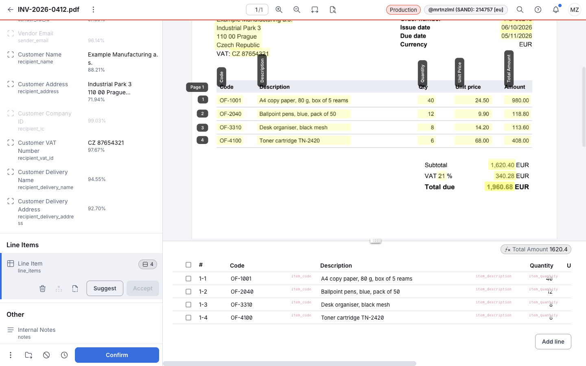
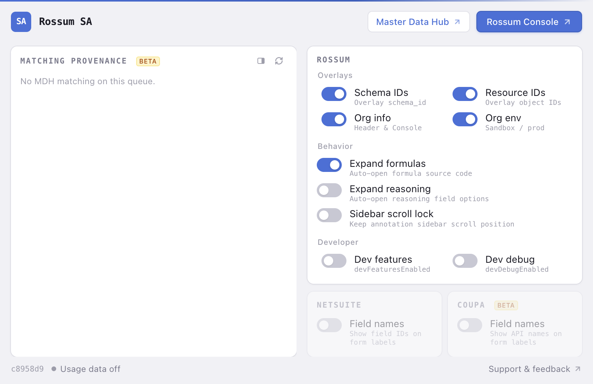
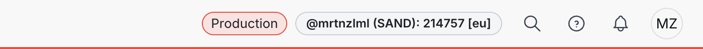
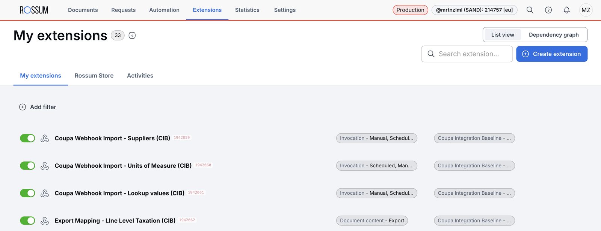
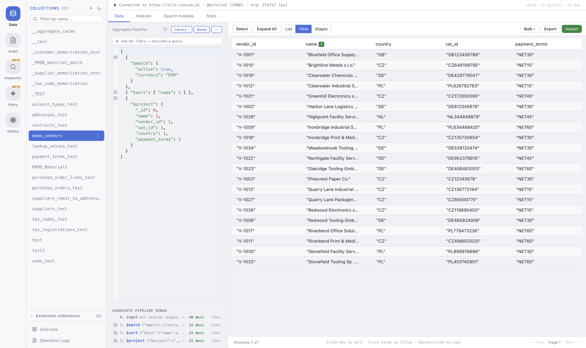
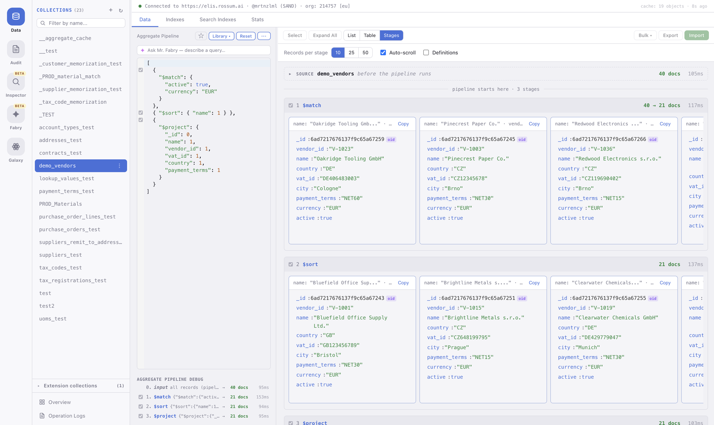
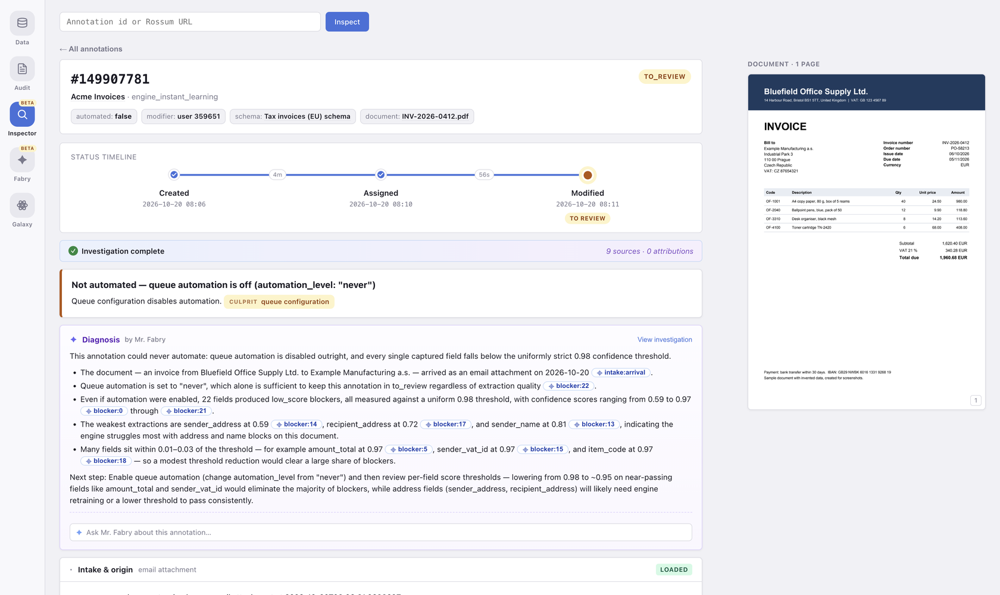
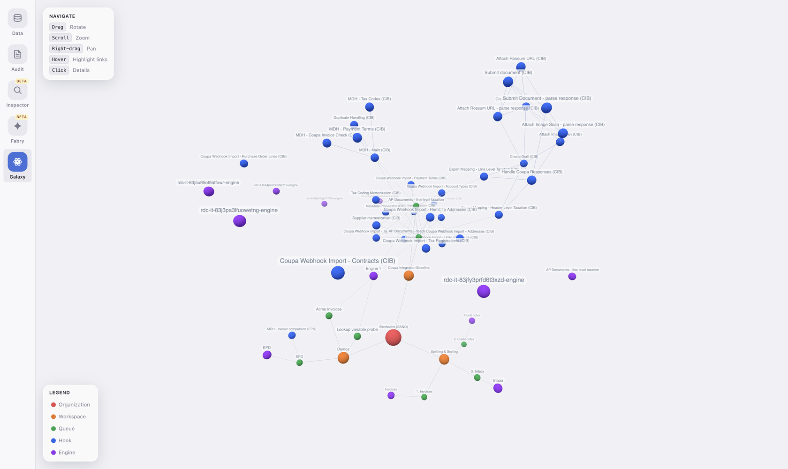

# Rossum SA Extension

A Chrome extension for people who configure and integrate [Rossum](https://rossum.ai), most of
all solution architects during customer onboarding. It adds three things:

- **Overlays in the Rossum, NetSuite and Coupa web apps.** You see the IDs and internal names
  you need for configuration (schema IDs, resource IDs, API field names) directly on the page.
- **The Rossum Console**, a separate page with tools for one Rossum organization: Data Storage
  management, the audit log, an annotation inspector, a chat assistant and a 3D map of the org.
- **A "Rossum" DevTools panel** that shows the API resource behind the current Rossum page.

Install it from the
[Chrome Web Store](https://chrome.google.com/webstore/detail/bljkbinljmhdbipklfcljongikhmnneh).



## How to use it

Click the extension icon on a Rossum, NetSuite or Coupa tab. The popup turns each page feature
on or off, and on a Rossum tab it has two buttons:

- **Rossum Console** opens the Console, signed in as you in the current organization.
- **Master Data Hub** opens Rossum's own Master Data Hub for the organization.



Every feature reads and writes with your own Rossum session. The extension has no server, and
it changes your organization only when you explicitly save or delete something.

## Features in the Rossum app

Toggled in the popup:

| Feature | What it does | Default |
|---|---|---|
| Schema IDs | Shows the `schema_id` on each annotation field, header fields and line items | Off |
| Resource IDs | Shows the IDs of queues, hooks, extensions, labels, rules, users and AI engines; click to copy | Off |
| Org info | Shows the organization's name, ID and deployment cell (for example `eu2`) in the top bar on every screen, so you can tell apart organizations in one organization group | On |
| Org env | Adds a Sandbox or Production chip and a colored line under the top bar. Sandbox means the organization's `sandbox` flag is set | Off |
| Expand formulas | Opens the source code of formula fields automatically | Off |
| Expand reasoning | Opens the options of reasoning fields automatically | Off |
| Sidebar scroll lock | Stops the annotation sidebar from jumping back to the top | Off |
| Dev features, Dev debug | Set Rossum's `devFeaturesEnabled` and `devDebugEnabled` page flags | Off |

Always on:

- **Closable validation tooltips.** Adds a × to validation tooltips on the annotation screen.
- **No Developer mode chip.** Hides Rossum's "Developer mode" chip from the top bar. It only
  repeats the popup's Dev features switch and takes room on a small screen.
- **Matching provenance.** On an annotation, the popup shows which MDH hooks and lookup fields
  produced each matched value. It can also open in Chrome's side panel, which stays open while
  you work.
- **Reviewing lock warning.** The popup warns when another user holds the open annotation in
  `reviewing`, and can release it.





## Rossum Console

A full-page app with a rail of tools for the organization you opened it from:

- **Dataset Management.** Browse, query, edit, import and export records in Data Storage
  collections. Write aggregation pipelines and debug them stage by stage. Manage regular and
  search indexes.
- **Audit Log Viewer.** Browse and filter the organization's audit log.
- **Inspector.** Explains what happened to one annotation, and why, as a diagnosis report.
- **Fabry.** A chat assistant over the Rossum Agent API. Chat is read-only.
- **Galaxy.** The organization's workspaces, queues, hooks, engines and their links as a 3D graph.
- **CIB deploy.** Deploys a release of the Coupa Integration Baseline into the organization. It
  reads the release from GitHub when you press Check or Deploy, checks the organization and the
  Coupa credentials first, and can resume an interrupted deploy. Unlike the other tools, a Deploy
  changes your organization.
- **Academy.** An onboarding training track for new partners. Hidden by default; it never
  changes your organization.









## DevTools panel

Open Chrome DevTools on a Rossum tab and choose the **Rossum** panel. It shows the API resource
behind the current page (queue, hook, schema, annotation and others), lets you run GET requests,
copy them as `curl`, compare configuration versions, and edit and save a resource after you
confirm the diff.

## Features in NetSuite and Coupa

- **NetSuite: Field names.** Shows the internal field ID next to each form label.
- **Coupa: Field names.** Shows the API field name next to each form label. On invoice pages
  the names come from page metadata (for example `currency_id`); on purchase orders and other
  pages they come from the page markup.


## Usage data

Optional usage data reports which of the extension's own features you use, so unused features
get removed instead of maintained. It is **off by default**; enable it in the popup. It sends
the feature's name and the extension version, and never a URL, an organization domain, a
credential, or any document, dataset or field data. [PRIVACY.md](PRIVACY.md) lists the exact
payload and every event name the extension can send.

## Development

```bash
npm install          # install dependencies
npm run build        # bundle src/ into dist/
npm run dev          # rebuild on file changes (JS only)
npm test             # run the tests
npm run typecheck    # type-check src/ and tests/
```

Load `dist/` as an unpacked extension in `chrome://extensions` (turn on Developer mode). After
you change HTML or CSS files, run `npm run build` again: watch mode picks up only JS changes.
After you reload the extension, also reload open Rossum tabs.

## Release

Run the **Release** workflow in GitHub Actions on `master`. It builds and tests the extension,
then uploads it to the Chrome Web Store. The version comes from the git commit, so do not edit
it by hand. Setup details are in
[docs/chrome-web-store-release.md](docs/chrome-web-store-release.md).
